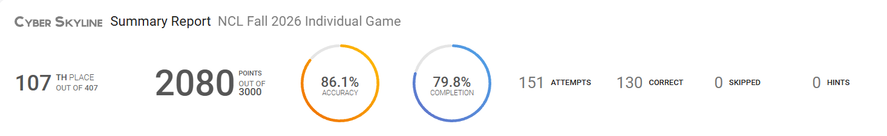
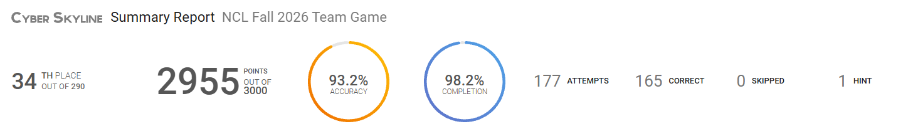

# Cybersecurity-Portfolio

# Welcome to My Cybersecurity Portfolio!

## About Me

My background actually started in architecture, but during COVID I decided to make a career change and pursue cybersecurity. I've always enjoyed technology and problem-solving, so cybersecurity seemed like a great opportunity to challenge myself and learn something new.

I'm currently working as a Cyber Security Analyst at TekStream, where I get to work with different security tools, investigate alerts, and continue building my skills. I also help with our Student SOC and Workforce Development programs, which has given me the opportunity to work with students who are getting started in cybersecurity.

## My NCL Experience

I've had the opportunity to participate in the National Cyber League (NCL), which has been a great way to put my cybersecurity knowledge to the test. The challenges cover a variety of areas, including scanning and reconnaissance, cryptography, password cracking, log analysis, and more.

One thing I really enjoyed about NCL was getting to work through problems that didn't always have an obvious answer. Some challenges were fairly straightforward, while others took quite a bit of research, troubleshooting, and trial and error. It was a good reminder that you aren't always going to know the answer right away, and sometimes you just have to keep working through the problem.

## Highlights and Takeaways

- **Hands-on experience:** Got more practice using tools like Nmap, Linux command-line utilities, and other cybersecurity tools to investigate challenges.
- **Problem-solving:** Learned to approach challenges from different angles when my initial attempts weren't working.
- **Teamwork:** Participated in the NCL Team Game, where we worked together through Discord, shared findings, and helped each other work through difficult challenges.
- **Continued learning:** Gained more experience in areas I don't necessarily work with every day, which helped me identify skills I want to continue developing.

## NCL Score Reports

## NCL Score Reports

Below are my results from participating in the National Cyber League (NCL) Individual and Team Games.

<table>
  <tr>
    <th align="center">Individual Game</th>
    <th align="center">Team Game</th>
  </tr>
  <tr>
    <td align="center">
      
    </td>
    <td align="center">
      
    </td>
  </tr>
</table>

## What's Next?

My goal is to continue building on what I've learned through both my professional experience and CTF competitions. I plan to use this portfolio to document my progress, share projects I've worked on, and continue improving my technical skills.

Thanks for checking out my portfolio!
